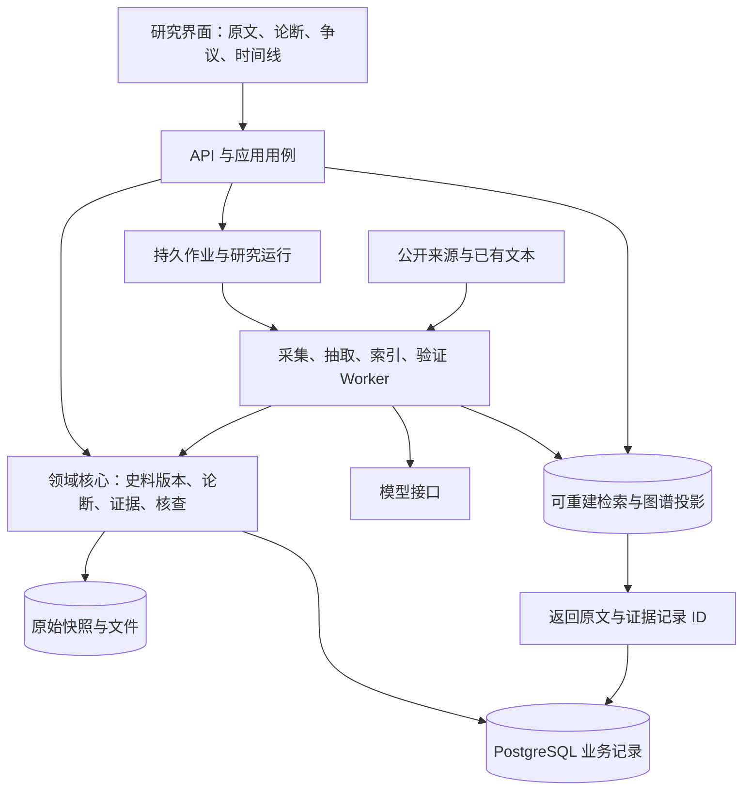

# EvidHist 架构设计分析

日期：2026-10-09。依据：[项目需求](../README.md)。项目已建立可运行的 Python 工程骨架、引用定位规则及检查入口，完整史料研究能力仍在设计中。以下架构选择需要真实材料和负载验证。软件能力来自文中一手资料，技术组合及取舍属于针对本项目的工程判断。

**项目定位：个人产品，代码计划在 GitHub 开源，持续向用户交付可使用和可维护的能力。** 历史研究是产品服务的使用场景；架构、算法和评测围绕用户任务、正确性、成本、恢复能力及版本交付设计。

本文说明设计目标与现有基础。本次只读复核中 3.14.8 的 `make check` 已通过，包括 76 项快速测试；其他完整门槛、新工具及新增阈值仍需各自验收，状态见[代码 Agent 交接清单](coding-agent-handoff-2026-10-09.md)。本会话后续仅维护文档，代码由其他 Agent 实现与验收。

## 1. 总体判断与设计前提

建议采用 **Python 模块化单体 + TypeScript 研究界面 + PostgreSQL 权威存储 + 可重建的检索与图谱投影**。API 与后台处理使用独立进程，共用领域代码；随着实测负载增长，再拆出专用检索、图计算或模型服务。

这一建议暂以个人或小团队开发、中文史料、macOS 开发与 Linux 运行、交互查询与离线批处理并存为前提。实际语料规模、硬件预算、团队语言经验和部署限制尚未确定，因此本文不承诺吞吐量、响应时间或工期。

架构的中心是四类持久记录：**原文版本、可核查论断、证据关系、核查判断**。检索、知识图谱、时间线与生成回答都应能回到这些记录。

必须由设计保证的约束：

1. 原文快照与规范化文本分别保存，引用始终绑定具体版本及位置。
2. 史料怎样记载、系统怎样抽取、研究者怎样判断分别有记录。
3. 支持、反对、提及与无法判断可以共存；不同来源的分歧不会被一次更新覆盖。
4. 同源转引保留依赖关系；来源独立性未知时保留未知。
5. 算法、模型或人工判断更新后，旧结果仍能回查，派生索引能够重建。
6. 作业重试、进程崩溃、人工修订不会造成重复论断发布或丢失已有证据。

## 2. 编程语言：按职责选型

| 语言 | 在 EvidHist 中的建议用途 | 主要理由与取舍 |
| --- | --- | --- |
| Python | 史料处理、抽取、检索实验、验证逻辑、API、后台作业 | 便于把数据处理和模型实验接入业务；需要类型检查、边界校验及明确的并发策略 |
| TypeScript | 原文对照、证据卡片、图谱、地图、时间线 | 适合复杂浏览器交互；前后端契约需要同步，运行时仍需校验外部数据 |
| SQL | 领域约束、版本查询、证据聚合、任务领取、图谱基础查询 | 是核心业务逻辑的一部分，需要理解事务、索引、执行计划和锁 |
| Java / Kotlin | 团队已有成熟 JVM 经验时的主后端备选 | 可以承担完整业务后端；若模型处理仍在 Python 中，会增加跨语言契约与部署成本 |
| Go | 采集调度或高并发网络服务的后续备选 | 是否引入应由实际瓶颈及团队能力决定；当前增加第二种后端语言的收益尚未证明 |
| Rust / C++ | 性能剖析确认的局部计算热点 | 可用于文本对齐、压缩或特定计算内核；需要承担构建、绑定与调试成本 |

**推荐起点：Python + TypeScript + SQL。** 若开发者已非常熟悉 Java，而 Python 经验有限，Java 业务后端搭配 Python 算法进程也成立；决定因素是维护能力和边界成本。

后端可采用 FastAPI、Pydantic、SQLAlchemy 与 Alembic，分别承担 HTTP 接口、输入输出校验、数据库访问和结构迁移。复杂检索及图查询保留直接 SQL 的空间。Pydantic 能验证结构，史料支撑关系仍需要领域规则检查；并行任务各自使用数据库会话。[Pydantic](https://docs.pydantic.dev/latest/)、[SQLAlchemy asyncio](https://docs.sqlalchemy.org/en/20/orm/extensions/asyncio.html)、[Alembic](https://alembic.sqlalchemy.org/en/latest/)

Python 的并发要按任务性质设计：等待网站、数据库和模型接口适合异步 I/O；大量文本计算、嵌入推理需要进程或独立计算服务，并按计算库实际行为选择。异步函数中直接运行阻塞代码仍会阻塞事件循环。[FastAPI 并发文档](https://fastapi.tiangolo.com/async/)

前端建议 React + TypeScript。静态类型帮助维护接口，但网络响应、导入内容与模型输出都要进行运行时校验。[React TypeScript 指南](https://react.dev/learn/typescript)、[TypeScript 类型说明](https://www.typescriptlang.org/docs/handbook/2/basic-types)

## 3. 软件工程：模块化单体与清楚的职责边界

图中表示职责与数据关系；初期检索、向量、图谱投影可以同在 PostgreSQL，API 与 Worker 可以来自同一代码仓库。

| 领域边界 | 对外提供什么 | 自己负责什么 |
| --- | --- | --- |
| 史料与版本 | 可回查的材料和引文锚点 | 来源、版本、快照、规范化映射、许可元数据 |
| 实体与事件 | 候选实体、对齐判断、事件参与关系 | 同名消歧、别名、事件同一性、时空限定 |
| 检索 | 带来源 ID 的候选证据 | 过滤、召回、融合、重排与召回评测 |
| 论断与核查 | 带理由的证据判断及冲突记录 | 原文支撑、来源依赖、冲突、不确定性、人工修订 |
| 研究过程 | 可恢复的分析任务与结果 | 步骤状态、输入版本、预算、失败与取消 |
| 展示与查询 | 面向研究者的可读视图 | 原文对照、图谱、时间线、地图及争议展开 |

外部依赖只在真实变化边界设置接口，例如来源适配器、模型调用、对象存储和检索器。领域对象不携带某个 Agent 框架的内部消息结构。一次修改优先落在对应领域内，避免每个功能都穿过大量仅转发参数的层。

工程基础应包括依赖锁定、数据库迁移、类型检查、结构化日志、API 契约、少量关键决策记录。对外公开 API 的字段含义要版本化，尤其是时间、证据状态与实体 ID。

## 4. 数据模型：先定义“记录了什么”，再选择数据库

建议的核心对象如下；这是概念模型，具体表拆分仍需通过真实材料验证。

| 对象 | 最少应表达的内容 |
| --- | --- |
| 作品与版本 `work / edition` | 作品、编著者、成书时间、版本关系、出版或整理信息 |
| 采集快照 `snapshot` | 获取地址、获取时间、文件散列、原始对象地址、使用条件 |
| 文本版本与片段 `text_version / passage` | 所属快照、规范化规则版本、章节/页码、范围、原文锚点 |
| 实体与提及 `entity / mention` | 人物/地点/机构等实体；每次提及位置及对齐状态 |
| 论断 `claim` | 主体、谓词、客体或值、否定、量词、时间、地点、适用条件、原始表述 |
| 证据关系 `evidence_link` | 论断与片段的支持、反对、提及或不足关系；判定理由及生成者 |
| 来源依赖 `source_dependency` | 转引、摘录、修订或共同来源；适用片段、依据与确认状态 |
| 冲突记录 `conflict_case` | 相关论断、共同讨论对象、冲突维度、候选/确认/未决状态 |
| 核查记录 `assessment` | 核查者、方法、证据集合、判断、时间、所替代的旧判断 |
| 处理与研究运行 `processing_run / research_run` | 输入材料集合、算法/模型/提示词版本、输出、成本、失败状态 |
| 作业与事件 `job / outbox` | 幂等键、领取租约、重试、取消、待更新索引的事件 |

史料中“某人认为 P”和系统判定“P 有证据支持”必须可分别表达。一个来源对某个论断的态度可用带来源的证据关系记录；随着复杂引语需求增加，再扩展独立的陈述者、陈述行为对象。

**README 中的“事实、推断、争议、未知”适合作为用户可读标签，数据库不宜只设一个四选一字段。** 建议至少分别保存：

- 表述性质：直接记载、推断、被转述的观点。
- 支撑状态：支持、反对、证据不足、尚未核查。
- 争议情况：关联哪些冲突，是否仍未解决。
- 审核情况：机器候选、人工确认、已修订。

这些维度允许“有明确记载，同时存在争议”或“推断有部分支持，但尚未人工核查”。标签展示由这些记录产生。

引用建议同时保存 `text_version_id + passage_id + [start, end) + exact_quote + context`。字符偏移需约定计数单位，特别检查 Python 字符与浏览器 UTF-16 代码单元的差异；全文规范化规则变化时创建新版本。短文本及页码共同用于回查，单独使用 URL 或偏移容易失效。该设计借鉴 W3C 的文本位置、引文及状态选择器。[Web Annotation](https://www.w3.org/TR/annotation-model/)

来源与处理记录可借鉴 PROV-O 的派生、引用、修订关系；论证与判断可参考 CRMinf。建议先采用其概念，在确有交换需求时再实现完整标准映射。[PROV-O](https://www.w3.org/TR/prov-o/)、[CRMinf](https://cidoc-crm.org/extensions/crminf/html/CRMinf_v1.2.1.html)

## 5. 数据库：权威记录集中，派生查询逐步扩展

| 选择 | 建议角色 | 采用条件与代价 |
| --- | --- | --- |
| PostgreSQL | 在线业务权威数据库 | 管理论断、引用、修订、约束和任务；需要维护迁移、索引与备份 |
| pgvector | 同库向量检索 | 减少早期同步负担；按真实过滤条件评测精确与近似检索 |
| 文件系统 / 对象存储 | 原始 HTML、文本、文件及处理产物 | 先用持久目录即可；按内容散列寻址，另存来源与版本信息 |
| PostGIS | 空间查询和历史地点几何数据 | 地图需要范围、距离、包含等查询时启用；地名沿革仍需领域模型 |
| SQLite | 单机探索、离线材料包或本地缓存 | 适合轻量本地场景；单文件写并发有限 |
| DuckDB + 列式文件 | 语料统计、评测分析、离线导出 | 承担分析任务；共享在线事务仍集中在主库 |
| 专用全文检索引擎 | 高负载关键词检索的候选扩展 | 分词、排序、索引更新或延迟需求经同语料测试证明有收益时引入 |
| Neo4j / RDF 存储 | 深层图查询或语义互操作的候选扩展 | 根据实际路径查询、标准交换需求选择；增加同步、备份和学习成本 |

SQLite、DuckDB 与 Neo4j 的能力边界和官方依据详见[技术核验](research/architecture-technical-sources-2026-10-09.md)。当前没有足够负载证据证明需要同时部署多种在线数据库。

**中文检索是需要专项验证的环节。** PostgreSQL 自带全文检索不能直接等同于高质量文言文分词。建议先构建版本化的词、字级片段与别名通道；短人名、异体字、无标点原句分别做检索用例。`pg_trgm` 可作为辅助模糊匹配，效果需要实测；`ts_rank` 的排序规则也不能写成 BM25。若选择 BM25，要明确实际实现及分词方案。[文本解析器](https://www.postgresql.org/docs/current/textsearch-parsers.html)、[全文排序](https://www.postgresql.org/docs/current/textsearch-controls.html)、[pg_trgm](https://www.postgresql.org/docs/current/pgtrgm.html)

**向量过滤影响召回。** pgvector 的近似索引扫描后应用过滤，年代、作品或语料集过滤可能使返回结果不足。先以精确检索建立基线，再比较迭代扫描、过滤列索引、分区等方案。检索无结果只说明本次搜索未找到证据。[pgvector](https://github.com/pgvector/pgvector#filtering)

权威表中的主键、外键、必填条件及业务唯一性由数据库约束保障；来源扩展字段可以使用 JSONB。涉及外键、查询过滤与一致性的重要字段应有明确列与含义。论断文本相似或散列相同只用于生成合并候选，语义合并仍需考虑主体、时间、否定和适用范围。

更新业务记录与写入待处理事件应放在同一事务内。索引消费者按版本幂等更新，并记录已处理版本；索引滞后时界面应能说明。原始文件先可靠落盘并校验，再提交引用它的数据库记录；数据库与对象存储之间的失败通过待处理状态及孤立对象清理恢复。

## 6. 历史时间与地理：专门建模

时间至少分为事件发生时间、史料形成时间、系统采集时间和判断更新时间。前两者可能存在历史不确定性；系统采集与判断更新时间使用现代 UTC 时间戳。

历史时间应保存：原记年文本、历法/年号、可能范围、精度、换算规则与来源，以及多种候选解释。按年可使用明确纪年约定的整数区间；日级日期只在换算依据充分时使用统一的日序或历法字段。公元前纪年和是否包含零年必须写入契约。

PostgreSQL 使用向前推算的公历进行日期计算；Python 标准 `datetime` 的年份范围为 1–9999。数据库能存某个古代日期，并不意味着它完成了中国历史历法换算。模糊年代不应补成看似精确的月日。[PostgreSQL 日期](https://www.postgresql.org/docs/current/datatype-datetime.html)、[Python datetime](https://docs.python.org/3/library/datetime.html)

地点宜分为“地点身份”和“某时段的名称、行政归属、边界或位置”。未知边界可保留点位及误差范围；现代地名匹配只是候选线索。PostGIS 负责空间运算，历史沿革由项目记录，CHGIS 的时序地名模型可作参考。[PostGIS](https://postgis.net/docs/using_postgis_dbmanagement.html)、[CHGIS 数据模型](https://chgis.fas.harvard.edu/pages/database/)

人物对齐同样需要别名、活动年代、籍贯、亲属和任职上下文。CBDB 可作为外部候选来源，但外部 ID 的对应关系也应保存匹配依据、数据版本及未决状态。[CBDB API](https://cbdb.hsites.harvard.edu/cbdb-api)

## 7. 操作系统与运行方式

建议开发继续使用 macOS，部署与集成测试以 Linux 为目标。初期运行单机上的 API、Worker、PostgreSQL 和持久文件存储；需要隔离浏览器或模型计算时增加相应进程。容器用于打包依赖和限制资源，运行规格以实际测试确定。

| 操作系统问题 | 本项目的具体影响 | 设计措施 |
| --- | --- | --- |
| 进程与线程 | 浏览器、解析器、模型计算可能拖慢交互请求 | API、采集和重计算分开调度，限制各自并发 |
| 内存 | 文本批次、向量索引、浏览器页面、模型权重同时占用 | 流式处理、有界批次、显式内存预算、失败重领 |
| 网络与文件描述符 | 来源站点和模型接口需要连接池 | 分主机限流、超时、连接上限与背压 |
| 文件持久性 | 临时目录或容器重建可能丢原文 | 原文使用持久卷/对象存储，散列校验及备份恢复 |
| 信号与进程终止 | 发布、取消、内存耗尽可能中断作业 | 优雅退出、短事务、租约到期恢复、幂等提交 |
| 平台差异 | 路径大小写、ARM/x86 依赖、GPU 后端不同 | 在目标平台验证镜像与依赖；记录平台和模型配置 |

Docker 默认不自动为容器设置 CPU 与内存上限，需要显式配置。数据库、浏览器和模型作业不宜争抢全部资源。[Docker 资源限制](https://docs.docker.com/engine/containers/resource_constraints/)

容量估算从组成部分开始。例如，**100 万条、1024 维、float32 向量的纯数值约 4.10 GB**，还未计算行、图索引、元数据和工作内存。这只是计算示例，不是当前容量目标。另记录原文与索引体积、过滤后召回、查询延迟、批处理时间、队列积压及单任务模型费用，实测后再决定扩容方向。

## 8. 爬虫与史料采集

建议的获取顺序是：**官方导出或 API → 普通 HTTP → 必要的浏览器渲染**。批量网页任务可使用 Scrapy；确有动态交互需要时使用 Playwright，并限制浏览器进程和页面数量。[Scrapy 设置](https://docs.scrapy.org/en/latest/topics/settings.html)、[Playwright 上下文](https://playwright.dev/python/docs/browser-contexts)

采集与文本解析分为两个可重试步骤。每个来源适配器输出统一材料描述：来源 ID、原始地址与最终地址、获取时间、响应元数据、内容散列、原始对象位置、许可信息、解析器版本。解析失败时仍保留快照，以便修正解析器后重跑。

关键处理包括：

- 按来源配置并发、间隔、体积上限和重试；限流时退避，避免多 Worker 合计超过站点预算。
- 记录 robots 获取结果与决策；规则和材料使用许可分别核查。RFC 9309 明确 robots 并非访问授权。[RFC 9309](https://www.rfc-editor.org/rfc/rfc9309.html) 来源选择、用途授权与许可证快照要求见[史料来源与许可指南](source-licensing-guidance.md)。
- 按文件散列识别完全相同内容，用文本片段重合生成近重复候选；正文、注文与整理者说明保持区分。
- 相同内容可以共用存储对象，但每个网站、版本及获取记录仍然保留；内容相似不足以证明来源独立或依赖。
- 网页变更生成新快照；失效页面仍可回查已有且依法保留的版本。增量请求与缓存规则须按来源实现。
- 下载端限制可访问协议、地址范围和重定向目标；解析不可信内容时限制大小、时间及进程权限。

普通网页正文抽取器容易混合正文、目录、注释和导航。每个来源应有代表性样例，检查章节、注释层级和引用位置，不能只验证“页面抓到了文本”。

## 9. 核心算法：从候选生成走向可核查判断

### 9.1 文本规范化与定位

保留原文，另外产生用于检索的规范化表示。繁简、异体字、标点及空白处理记录规则版本与位置映射；不可逆转换保留原始字符和候选。分段优先遵循篇、卷、段、注文层级，在可回查的段落范围内再建立检索块。

### 9.2 实体识别与消歧

采用“词典/规则候选 + 模型抽取 + 上下文对齐”的组合：候选生成关注召回，自动合并强调精确率。根据别名、活动年代、关系和上下文给出候选及理由；不确定的提及允许暂不链接。官职、人物和地点不同类型不能仅按表面文本合并。

CHisIEC 可用于观察古代汉语实体、关系抽取的任务设计，但本项目仍需按目标史料和版本建立验证集；其标注类型不能代表全部历史关系。[CHisIEC 论文](https://aclanthology.org/2024.lrec-main.283/)

### 9.3 混合检索与重排

推荐比较三个基线：词/字检索、向量检索、两者融合。查询可扩展别名和异体字，保留原查询及扩展依据；先检索具体证据，再适量补充邻接实体和上下文。

融合可采用 RRF：`score(d) = Σ 1 / (k + rank_i(d))`，只对实际召回该文档的通道求和。它融合排名，避免直接相加不同含义的分数；常数、候选数和通道权重需要本项目验证。[RRF 原论文](https://cormack.uwaterloo.ca/cormacksigir09-rrf.pdf)

BGE-M3 等公开模型可作为可复现实验候选，模型卡中多语言检索能力不等于文言文检索保证。重排只在召回候选中工作；应检查其是否把反证排除。按人物别名、原句、时间、冲突与解释类问题分别评价。[BGE-M3 模型卡](https://huggingface.co/BAAI/bge-m3)

### 9.4 论断提取

将长回答或史料叙述拆成能够单独核查的论断，保留主体、事件、属性、数值、否定、量词和适用范围。结构校验通过后，继续检查原文跨度、实体引用及限定条件是否匹配。模型给出的字段完整性和语义正确性分别记录。

### 9.5 冲突检测

先确认讨论的是同一实体、同一事件或同一属性范围，再产生冲突候选。可计算规则检查互斥日期区间、数值范围、明确否定及关系约束；语言模型辅助处理解释差异，保留原文供复核。

避免对所有论断两两比较。先按实体、谓词、事件候选与范围分组，再在组内比较；单组过大时仍需控制复杂度和召回损失。不同时间任不同官职可能完全相容，记载缺失也不等于反对，时间区间重合更不等于相互证实。

### 9.6 来源依赖与独立验证

结合明示引文、版本关系、片段重合和已知转引记录建立来源依赖候选。依赖关系尽量限定到具体片段或论断：同一著作可能在不同问题上依赖不同材料。共同措辞只能提供线索，不能自动确认抄录。

独立验证至少检查引用是否存在、定位是否正确、原文是否支撑、是否有相反证据、来源关系是否清楚。换一个模型复述同一材料不会自动形成独立史料证据。对检索范围、未访问材料和依赖未知项作记录。

### 9.7 证据强度与不确定性

分别记录直接支撑程度、来源关系、版本状况、时间接近性、上下文完整性及冲突情况，再按可审阅规则给出等级与理由。来源可靠性应结合具体论断判断，不能给一本书打一次分后套用于全部内容。

模型输出概率、向量相似度和历史真实性是不同量。缺少人工标注与校准时，用明确状态和依据表达判断；不生成看似精确的“史实为真概率”。因果解释还要列出机制、时间顺序、替代解释和材料缺口，由研究评价支撑。

### 9.8 可追溯生成

生成器使用带固定 ID 的证据集合，输出论断与引用 ID 的对应关系。程序检查引用 ID、版本、位置和文本一致性，语义核查检查证据支撑范围。任何新增事实性内容都要进入核查记录，冲突与未知随回答展示。

引用质量、内容正确性和表达质量需分别评价；ALCE 的任务划分可作为方法参考，其公开结果不能替代中文历史材料上的验证。[ALCE 论文](https://aclanthology.org/2023.emnlp-main.398/)

## 10. 知识图谱：关系必须携带出处与限定条件

项目至少需要两类相连的关系：人物、机构、地点、事件组成的内容关系，以及史料版本、片段、抽取运行和判断组成的来源关系。

例如一条“甲曾任乙官职”的边，应能回查具体论断、时间范围、来源片段、是否为推断及核查状态。多个来源对时间有不同记载时，保留多条有出处的陈述。涉及人物、职位、地点、时间等多个参与项的事实，宜表示为任职事件，再连接参与实体。

实现建议：

- 初期用 PostgreSQL 的实体、论断和证据表形成图查询投影；从目标实体展开邻接关系。
- AB 路径采用有界 BFS 或适合需求的路径查询，限制关系类型、方向、跳数、时间及展开预算，并做环检测。只对最终结果设置 `LIMIT` 不足以约束展开成本。
- 每条路径检查关系组合是否有意义，并返回边的出处与争议；“存在路径”只说明满足所定义条件的连接存在。
- 深层路径查询成为核心负载且 SQL 实测不合适时比较 Neo4j；需要跨机构语义数据交换时比较 RDF/SPARQL。选择依据是查询与交换需求。

PostgreSQL 递归 CTE 与 Neo4j 最短路径都提供遍历手段，具体计算预算和证据语义需由项目定义。[递归 CTE](https://www.postgresql.org/docs/current/queries-with.html)、[Neo4j 路径](https://neo4j.com/docs/cypher-manual/current/patterns/shortest-paths/)

GraphRAG 可作为后续研究候选：其全局查询利用社区摘要，局部查询结合图及文本。针对本项目，摘要应视为可追溯的派生材料，不能成为无需复核的独立史料；先测普通混合检索与有界图扩展的效果，再比较收益与索引成本。[GraphRAG 查询文档](https://microsoft.github.io/graphrag/query/overview/)

## 11. Agent、工作流与用户界面

采集、结构校验、保存和索引更新采用明确步骤。研究 Agent 可以决定下一步检索什么、需要补什么证据，并调用受限工具；论断状态和引用有效性的更新仍经领域用例检查。

有跨步骤恢复、暂停复核需求时，可用 LangGraph 管理研究过程。其恢复可能从受影响节点函数开头重新执行，因此数据库写入和外部副作用仍需幂等。工作流检查点保存运行进展，业务数据库保存可审计的史料与核查记录。[LangGraph 恢复语义](https://docs.langchain.com/oss/python/langgraph/graph-api#re-execution-and-idempotency)

建议作业幂等键包含输入版本、处理器版本、配置与模型信息，并另外记录每次执行尝试。使用短事务领取带租约的作业，崩溃后允许重领；完成时校验租约/尝试代次，防止旧 Worker 覆盖新结果。模型调用超时可能已产生费用，需要保留调用状态及供应商请求 ID，不能仅凭本地重试保证外部调用恰好一次。

MCP、AG-UI 等接口可在需要外部接入时由适配层承接，核心论断和证据对象应保持独立。当前框架选择没有必要决定全部领域数据结构。

研究界面应支持围绕同一论断同时查看原文、支持与反对证据、来源依赖及核查理由。图谱与时间线按局部范围逐步加载，点击任一关系能回到证据。长任务显示可区分的等待、运行、部分完成、失败与取消状态，并提供可恢复的运行 ID。

## 12. 测试方法论：用不同层次验证不同承诺

测试从业务不变量出发，先确定“输入、操作、可观察结果及失败状态”，再选择工具。正常、边界、错误、冲突与恢复路径都需要有独立的预期依据；预期值来自明确规范、人工标注或可核查样例。对内部实现的模拟只用于隔离外部边界，核心领域规则通过公共接口验证。

当前工程已提供单元、属性、API 组件、流程场景、真实 PostgreSQL 集成与真实 HTTP 系统测试。研究 UI 与真实模型尚未接入，后续按本节的方法增加对应测试；测试完成情况按各自层次报告。

### 12.1 分层策略与测试目录

| 层次 | 重点验证 | EvidHist 的具体样例 | 执行入口 |
| --- | --- | --- | --- |
| 单元测试 | 确定性领域规则、错误契约及边界 | 错版本、越界、引文不符、严格 Schema；后续加入区间冲突与来源归并 | `tests/unit/`，`make test` |
| 属性测试 | 大量输入下始终成立的不变量 | 任意 Unicode 引文能够定位；同文不同版本拒绝；越界不能静默截断 | `tests/property/`，Hypothesis |
| 组件与契约测试 | HTTP 序列化、错误码、状态和输入输出结构 | 字符串偏移拒绝、额外字段拒绝、数据库不可用返回 503 | `tests/component/`，FastAPI TestClient |
| 集成测试 | 真实组件、驱动与配置的交界 | PostgreSQL 参数绑定、约束/事务、pgvector 过滤下的精确检索基线 | `tests/integration/`，`make test-integration` |
| 流程场景测试 | 多步骤组合后的领域行为 | 提供原文本定位 → 新版本拒绝旧锚点 → 新锚点成功 → 原文本仍可定位 | `tests/scenario/`，`make test` |
| 系统测试 | 独立进程、真实网络、运行配置与依赖 | 启动服务，经真实 HTTP 检查数据库就绪和引用 Unicode 传输 | `tests/system/`，`make test-system` |
| UI 测试 | 研究者能够完成关键任务 | 原文高亮、争议双方、图谱回查、时间线过滤、长任务恢复 | 首个研究界面落地时接入 Playwright |
| LLM 评测 | 模型/提示词变更后的任务质量 | 引文提取、重复原句消歧、材料不足时保留未知 | `evals/` 固定案例与预测文件评分器 |
| 变异测试 | 测试是否会发现故意引入的代码错误 | 删除版本校验、改变区间比较、错误返回位置 | mutmut，`make mutation` |

测试以快速且稳定的规则测试为主，在关键依赖边界使用真实组件，为完整业务流程保留少量高价值系统与 UI 用例。数量比例随风险和运行成本调整。

### 12.2 单元测试与测试数据

采用 Arrange–Act–Assert：准备已知材料与预期结果，调用公共接口，断言结果或明确失败。参数化同一规则的边界，例如起点为零、终点等于文本长度、空区间、反向区间、越界、同名不同版本、空引文及扩展汉字。

领域用例优先保留具体的小样例。真实材料记录版本、出处、位置和标注依据；合成样例明确标为合成。时间与随机数在测试边界可控，外部模型、网站及生产数据库不进入快速测试。

只检查返回对象“存在”或 HTTP 200 不够：同时验证引用对应哪份材料、哪些字、何种限定范围，以及错误是否被正确表达。错误码和对外字段是契约，内部函数调用次数通常不是契约。

### 12.3 集成测试与环境隔离

数据库测试使用独立的 `evidhist_test` PostgreSQL，容器版本固定到镜像摘要；局部 SQL 探针使用临时表。显式要求测试 DSN，错误环境直接失败，避免将未执行的测试报告为通过。SQLite 可以测试本地场景，PostgreSQL 的驱动、事务与向量扩展仍由真实 PostgreSQL 验证。

业务持久化进入实现后，集成测试增加：从空库升级迁移、旧库升级、约束失败回滚、并发领取、租约代次、事务与 outbox、重试去重、索引更新及原文文件恢复。每项通过该组件的公开接口观察结果，不依赖不相关的内部步骤。

来源 HTTP 与模型边界优先使用本地受控服务，覆盖超时、429、5xx、重定向、响应体过大、非法 JSON 与不支持的字段。真实网站采集和外部工具兼容测试单独配置，保留版本与结果。MCP 接入后核对工具发现、参数/结果 Schema、错误、取消及传输行为。

### 12.4 系统测试与 Workflow Scenario Test

系统测试从独立服务进程和真实网络发起请求；组件测试在进程内验证 HTTP 契约。两者可以使用同一业务样例，但记录不同的完成证据。

完整研究流程逐步加入固定场景：支持材料齐全、来源转引、观点冲突、证据缺失、模型返回非法结构、重复执行、人工修订后恢复、取消与部分完成。断言论断、引用、来源依赖、争议及持久结果，而不是要求模型每次生成完全相同的长文本。

故障场景在关键提交边界注入失败：文件保存后/数据库提交前、业务事务提交后/索引更新前、作业重领时、外部调用已执行但本地超时。核对实际副作用、旧版本可回查、失败状态与恢复后的结果。轮询使用超时与可观察状态，避免用固定长等待掩盖问题。

### 12.5 UI 测试

建议使用 Playwright，在受控材料和可重复后端状态上启动真实浏览器。核心场景包括：打开一个论断，定位原文并检查高亮字符；展开支持与反对证据；点击图谱边回到对应片段；切换时间范围；刷新或重新连接后恢复任务状态。

优先使用可访问角色、标签和稳定测试 ID 定位，使用浏览器断言的自动等待。测试验证实际数据与交互结果；视觉截图比较只用于必要的布局回归，并固定视口、字体及渲染环境。失败保留 trace、截图和网络信息，重试后通过也记录为不稳定用例。[Playwright 测试文档](https://playwright.dev/python/docs/test-runners)

目前没有研究界面，因此没有 UI 通过结果。首个界面合入时同时提供浏览器测试入口、依赖、浏览器安装步骤与 CI 作业，不能使用空目录或全部跳过代替完成证据。

### 12.6 Hypothesis 属性测试

先写业务不变量，再设计生成范围。例如：

- 在任意前后文中插入一段已知引文，定位结果必须仍是该引文。
- 内容相同但版本不同，不能通过版本绑定检查。
- 引用终点超出原文长度，不能被 Python 切片静默截断后接受。
- 后续领域属性：规范化定位能够回到原文；重试不增加业务结果；来源家族内重复材料不增加独立证据；图遍历预算和环处理总能终止。

生成输入覆盖空白、重复片段、扩展汉字、组合字符、极端区间及未知值。失败时保留 Hypothesis 缩减后的反例，并把稳定的重要反例加入显式回归用例。人工预期和随机生成的属性相互补充。[Hypothesis](https://hypothesis.readthedocs.io/en/latest/)

### 12.7 mutmut 变异测试

先让普通测试稳定通过，再让 mutmut 修改条件、运算符、常量或返回值，观察测试能否发现错误。当前范围限定为引用定位领域文件，避免一开始对框架启动、第三方代码和全部 I/O 进行变异。

结果分别处理：被测试杀死、幸存、没有相关测试、超时、可疑失败、工具崩溃、跳过。正常运行退出不等于达到门槛。当前小范围门槛要求生成了变异、全部被杀死、无未测和异常状态；报告检查脚本拒绝空结果。

幸存项先检查语义：确实改变了公共行为，补充能够发现错误的用例；只改变不要求保证的行为，说明契约；等价变异记录原因与审阅依据。范围扩大后可以为有依据的等价变异建立逐项例外，不能笼统忽略整个文件或把超时自动算为测试有效。

项目使用当前 `source_paths` 配置及 `export-cicd-stats` 报告。mutmut 需要 fork；Linux/macOS 可运行，Windows 使用 WSL。其相关测试选择也可能限制 Hypothesis 包装后的调用可见性，所以关键边界同时保留明确的单元样例。[mutmut 官方文档](https://mutmut.readthedocs.io/en/latest/)

### 12.8 LLM Eval Case Set 与评分依据

固定案例保存输入材料及版本、任务、期望结构、引用/位置、未知判断及人工标注依据。预测结果单独保存，每条使用案例 ID 对齐；遗漏计为失败并留在分母，重复 ID 或未知 ID 使输入校验失败。模型、提示词、检索和语料版本随真实实验保存。

当前提供四个合成引用提取案例、离线 fixture 预测及评分入口，用于验证评分器、Schema、引文定位与未知判断的契约。`make eval-fixture` 通过只证明评分链路工作，真实模型必须提交独立预测文件并接受同一评分；复杂开放式解释另需人工 rubric 与评阅。

真实评测按任务类型分层，报告引用支撑、检索召回、冲突精确率与召回率、不确定性和未知比例、失败、费用及时间。格式/工具调用等确定性约束逐项检查；随机性较强的质量比较采用预先确定的重复次数与配对案例，记录波动。模型评审可辅助分类，不能替代引用回查或把同一模型的自评作为独立判据。

开发案例与冻结测试按作品、来源家族和近重复片段隔离。用于调优的 Badcase 进入开发回归集，另保留未参与调优的测试材料。测试门槛在比较前确定，缺失、超时和错误不从分母中静默移除。

### 12.9 覆盖率、失败治理与完成证据

pytest-cov 统计 `src/evidhist` 的行与分支覆盖，当前门槛为 90%，报告显示遗漏位置。覆盖率表示执行情况；变异测试、属性测试与业务场景检查断言质量和行为正确性。当前骨架即使得到高覆盖率，也不能推出完整历史研究能力已经可靠。[pytest-cov](https://pytest-cov.readthedocs.io/en/latest/)

每次失败区分产品错误、测试错误、环境错误和外部服务错误。跳过、预期失败与例外都需要原因和后续处理；不稳定用例不能靠无限重试变成通过。保存测试报告、运行环境、锁文件版本与必要的失败产物，完成声明与实际执行范围一致。

## 13. Day 1 工程基础：方法论、组件与执行门槛

工程基线与业务功能一起进入首批提交。新能力同时提供 Schema、错误契约、对应测试和运行记录，质量检查在本地与 CI 使用同一入口。

| 方法 / 组件 | 项目中的用途 | 当前接入位置 |
| --- | --- | --- |
| Ruff | 统一格式、导入和静态规则；中文史料标点显式允许 | `pyproject.toml`，`make lint / format` |
| Pyright | 对领域与 API 严格检查，检查测试和工程脚本的基本类型 | `pyproject.toml`，`make typecheck` |
| pytest | 单元、组件、集成、系统和场景测试，严格 marker/config | `tests/`，分层 Make 入口 |
| pytest-cov | 行与分支覆盖、遗漏报告、覆盖门槛 | `make coverage`，`reports/coverage.xml` |
| Pydantic / Schema | 输入输出结构、严格类型、未知字段与不可变版本对象 | 领域与 API 模型；严格模式对各入口实际测试 |
| Workflow Scenario Test | 多步骤组合、版本变化、恢复及失败结果 | `tests/scenario/` |
| LLM Eval Case Set | 固定任务和独立预测文件，版本化评分依据 | `evals/`，引用提取评分器 |
| Integration Test | 真实 PostgreSQL/pgvector、驱动、事务及 HTTP 进程 | `tests/integration/`、`tests/system/` |
| pip-audit | 审计完整锁定的运行与开发依赖；收集失败使检查失败 | `uv.lock` 导出，`make audit` |
| pre-commit | 提交前检查格式与类型，推送前运行快速测试 | `.pre-commit-config.yaml`，`make hooks` |
| mutmut | 检查核心测试是否捕获逻辑变更，拒绝空/未完成报告 | `make mutation`，报告门槛脚本 |
| Hypothesis | Unicode、版本与位置边界的属性检查 | `tests/property/` |
| bandit（2026-10-18 起替代 Semgrep） | 扫描命令执行、动态执行、反序列化、TLS 模式 | `pyproject.toml` 的 `[tool.bandit]`，`make sast` |

Pydantic 结构校验与业务正确性分别检查；严格模式在 Python 对象和 JSON 入口存在差异，因此对实际 HTTP/模型入口做契约测试。[严格模式](https://docs.pydantic.dev/latest/concepts/strict_mode/)

### 13.1 依赖、环境与目录

设计基线定为 Python 3.14，选定补丁版 3.14.8，使用 `src/` 包布局；运行、开发、变异和安全依赖分组，`uv.lock` 固定完整解析结果。新配置已开始同步，完成状态以交接清单和实际检查记录为准。更新依赖时重新执行相关检查，避免只改版本声明而不更新锁文件。版本选择依据见第 18 章。

Pyright 的 npm 引擎由 Microsoft 维护；当前 Python 工具链使用 PyPI 社区 wrapper，依赖和版本纳入锁文件，CI 显式提供 Node。前端开始实现时另建立 TypeScript、前端测试与浏览器依赖的锁定配置。

原文、数据库、模型密钥与工具缓存分别管理。测试容器只绑定本机地址、使用专属数据库与标签，采用临时存储；清理脚本只处理该标签的测试容器。原始业务材料使用持久存储，不能放入此测试容器。

### 13.2 本地与 CI 的执行分层

| 时机 | 必须执行 | 成本控制 |
| --- | --- | --- |
| 编辑中 | 格式、Lint、类型与所改规则测试 | 快速反馈，固定样例不访问外部服务 |
| 提交前 | Ruff 检查、格式检查、Pyright | pre-commit 使用项目环境；CI 仍重复检查 |
| 推送前 | 单元、属性、组件、场景测试 | 本地 hook 可被绕过，因此不承担最终合入保证 |
| 每个 PR | 上述检查、真实数据库集成、系统测试、覆盖、fixture 评分、安全审计与当前核心范围变异 | CI 作业分开，保存失败报告，限制运行时间 |
| 相关功能变更 | 模型/提示词/检索变更的真实评测；首个 UI 后的关键浏览器流程 | 根据变更影响选择，真实模型有显式预算 |
| 发布前 | 全部适用检查、迁移/恢复、制品启动和关键场景 | 测试通过的同一锁定版本与制品进入交付 |

已提供 GitHub Actions 配置，官方 Action 固定到核验的提交 SHA，工作流权限为只读；镜像固定摘要。未来接入远程仓库时配置必要状态检查与分支保护，才能把 CI 结果变成强制合入门槛。当前没有远程 CI 执行记录。

### 13.3 安全与交付护栏

pip-audit 使用从锁文件导出的完整传递依赖及哈希，分别解释漏洞发现与无法完成审计的失败；`--no-deps --disable-pip` 基于完整精确锁定输入，避免二次解析。[pip-audit](https://github.com/pypa/pip-audit)

bandit 使用受版本控制的本地配置（`[tool.bandit]`，含逐条说明的豁免），发现任何命中或工具错误都使检查失败；`tests/unit/test_security_scan.py` 用植入的危险模式（`os.system`、`eval`、`pickle.loads`、`verify=False`）验证门槛真的会失败。当前规则是项目基础护栏；后续按真实风险扩充规则和带注释的正反例，不能把无命中解释为不存在漏洞。[bandit](https://bandit.readthedocs.io/)

pre-commit 当前本地 hooks 使用 4.4+ 的 `language: unsupported`，依赖已安装的项目环境；配置本身纳入版本控制，hooks 安装在当前仓库。规则误报按具体位置、原因及复核记录处理。[pre-commit](https://pre-commit.com/)

业务表建立时同步引入迁移与空库/升级测试；首个外部调用同步引入超时、失败和预算约束；首个后台作业同步引入幂等、恢复与租约检查；首个 UI 同步引入真实浏览器测试。这些按功能出现的时点落实，不用尚无业务对象的空测试占位。

实际启动和检查命令见[开发与检查说明](development.md)，一手来源见[测试与工程技术核验](research/testing-engineering-sources-2026-10-09.md)。

## 14. 评测、可靠性与运维

### 测什么

| 层次 | 有意义的验证 |
| --- | --- |
| 数据完整性 | 原文散列、版本关系、引用回查、规范化偏移、撤销错误实体合并 |
| 确定性规则 | 时间区间、否定和量词、支持/反对关系、重复来源、不可计算指标 |
| 检索与抽取 | 原句/别名/反证召回，实体对齐精确率与召回率，论断是否保留限定条件 |
| 验证质量 | 引用正确性与覆盖、冲突精确率及召回率、不确定性标注、未知比例、错误完成声明 |
| 故障恢复 | 提交前后崩溃、重复交付、过期租约、索引滞后、模型超时和取消 |
| 研究体验 | 完成同一任务的检索、阅读、核对和修改总时间，错误与遗漏 |

README 的指标可保留为对外概览，工程评测还需同时观察精确率与召回率、未知数量与任务覆盖，避免“全部报冲突”或“全部未知”得到误导性结果。不存在金标准的复杂因果解释应记录评阅依据及分歧。

评测集按作品、来源家族或版本隔离开发与测试，检查近重复泄漏。错误样例先进入开发集；若已据此调优，应从另一批材料选出未参与调优的测试案例。保存语料快照、模型配置、提示词和算法版本，结果可追溯不等于外部模型必然能够逐字重现。

### 运维与信任边界

初期即可贯通 `run_id / snapshot_id / claim_id`，观察作业积压、检索耗时、引用失败、模型费用和人工修订量。记录足够的错误上下文，避免把密钥或受限原文写入普通日志。OpenTelemetry 可用于关联 traces、metrics 与 logs。[OpenTelemetry](https://opentelemetry.io/docs/concepts/signals/)

备份覆盖数据库、原始对象和恢复配置，并实际验证恢复后能回查同一引用；向量及图谱索引应能从版本化输入重建。下载内容、网页文字和模型回复都作为待验证数据处理，避免获得任意文件、SQL 或系统命令权限；前端安全渲染史料内容。

## 15. 备选架构与升级依据

| 方案 | 适合情况 | 对本项目的判断 |
| --- | --- | --- |
| 单机 Python + SQLite + 文件 | 快速检验材料模型和算法 | 可用于探索；多进程作业和共享在线使用时需重新评估写入协调 |
| Python 模块化单体 + PostgreSQL + Worker | 小团队完成采集、检索、核查与界面闭环 | 推荐基线，能够集中处理一致性和版本问题 |
| 多服务 + 独立搜索、图数据库、任务平台 | 多团队、独立扩缩容或明确的专用查询负载 | 需以收益证明同步、部署、恢复和维护成本 |

升级触发条件应具体到瓶颈：搜索延迟或召回不达标，再比较专用搜索；图遍历成为热点，再比较图数据库；后台任务影响在线请求，再拆资源或主机。分区、缓存和新服务都应有同语料的前后对照。

建议先用一个纵向用例验证架构：导入两份有版本信息的文本，定位同一事件的不同记载，保存论断及证据关系，展示分歧，并在重新解析或重试后仍能回查旧引用。

可用合成材料检验边界：甲本称同一事件发生于某年三月，乙本称五月，丙本明示转引甲本。系统应保留三份出处、两种时间记载和一条转引依赖；若事件同一性尚不确定，则记录候选冲突，等待复核。这个用例同时检查版本、实体、时间、来源独立性与图谱表达。

开始实现前最值得确定的事项是：首个材料包及版本、论断和标签语义、历史时间表示、来源依赖规则、可核查样例及硬件预算。语言和数据库可以支持这些规则，最终效果取决于规则与真实材料是否匹配。

附：[基础技术的一手资料核验](research/architecture-technical-sources-2026-10-09.md)。

## 16. 前端产品工程可靠性方案

前端采用 React + TypeScript，以 Node 24 为共同工具基线。界面承担原文、证据、争议与任务状态的呈现，必须准确表达后端给出的范围和未知信息，提供能够完成用户任务的交互。

### 16.1 与后端对应的工程组件

| 可靠性职责 | 后端对应 | 前端方案及接入要求 |
| --- | --- | --- |
| 静态规则 | Ruff | ESLint flat config，包含 TypeScript、React Hooks 与可访问性规则 |
| 格式 | Ruff format | 项目本地锁定 Prettier，编辑时格式化、CI 执行检查 |
| 静态类型 | Pyright | TypeScript `strict`、`noUncheckedIndexedAccess`、`exactOptionalPropertyTypes`；CI `tsc --noEmit` |
| 运行时输入输出 | Pydantic | 用 Zod 等 Schema 校验 API 响应与外部数据；类型断言不能替代校验 |
| 单元/组件 | pytest | Vitest + React Testing Library + user-event，通过用户可见行为断言 |
| HTTP 边界替身 | 受控 HTTP 服务 | MSW，覆盖成功、空结果、非法响应、429、5xx、超时及取消 |
| 系统/UI | 服务进程与系统场景 | Playwright 验证真实前后端关键流程，保留失败 trace、截图和网络信息 |
| 属性测试 | Hypothesis | fast-check 测 Unicode、日期范围、过滤与状态转换不变量 |
| 变异测试 | mutmut | StrykerJS + Vitest runner，先覆盖位置映射、过滤与任务状态规则 |
| 可访问性 | 语义化 API/清楚的错误 | axe-core 自动检查，加键盘、焦点、状态播报和对比度的人工验收 |
| 依赖审计 | pip-audit | npm 完整锁文件与审计；高风险问题阻断交付，其他发现也记录处置 |
| 提交/合入 | pre-commit + CI | 相同提交时间与消息规则；前端检查作为独立必要状态检查 |

工具能力及运行要求见[一手依据](research/product-engineering-sources-2026-10-09.md)。这些是选定的前端方案；目前没有业务前端代码、npm 锁文件或浏览器执行结果，不能把方案列出等同于已经接入。

### 16.2 契约、类型与状态

当前已有由后端导出的 `contracts/openapi.json` 快照，设计要求将其纳入版本控制并由 CI 检查与代码一致。前端建立时可采用 openapi-typescript 生成 TypeScript 类型并检查生成物是否更新，用 Zod 校验运行期数据。两者职责分别是编译期兼容与运行期有效性；静态生成类型本身不提供运行期验证。[openapi-typescript](https://openapi-ts.dev/introduction)、[Zod](https://zod.dev/)

前端状态使用可区分的状态类型，例如加载、成功、空数据、错误、未核查、争议与部分完成；状态转换有独立行为测试。材料尚未核查、请求失败或暂时无结果时，页面不能展示为验证成功。流式响应与任务恢复使用运行 ID 和事件/版本编号，防止重连导致重复显示或过期状态覆盖。

跨前后端最关键的边界是位置计数：后端引用偏移按 Unicode code point；JavaScript 字符串及 DOM Range 通常按 UTF-16 单元。位置转换保留明确映射，使用扩展汉字、组合字符、重复引文和版本变化案例核查高亮位置。不同版本的引用与实体 ID 不按显示文字自动合并。

### 16.3 组件、属性与变异测试

Vitest 验证不依赖浏览器的领域计算；Testing Library 验证加载、错误、空结果、争议展开、选择与取消等可观察行为。优先 role、label 和真实用户操作，避免断言内部 hook 调用次数或大段 DOM 快照。

MSW 在网络边界提供固定回应；至少有真实 API 契约/集成用例，防止前端和假服务共享同一个错误假设。没有必要把每个组件都做成端到端测试，也不能全部用模拟请求替代真实组合验证。

fast-check 的重点属性包括：原文与高亮片段一致；有效区间转换保留边界；同一批事件去重后重放不增加结果；取消后的旧响应不能把状态改成成功。Stryker 故意改变这些规则，逐项处理幸存、超时、未测和等价变异；扩大范围前先使基础测试稳定。

覆盖率显示遗漏路径，当前后端 90% 门槛可作为前端首轮参考，核心规则仍须有明确边界与反例。变异门槛针对范围和实际语义确定，不能以提高百分比为由添加无行为价值的断言。

### 16.4 浏览器、可访问性、安全与交付

首个页面同步加入真实浏览器场景：输入材料并定位引文、错误提示可读、版本不符被拒绝、界面高亮与原文一致。能力增长后加入证据双方展开、图谱回查、时间线筛选、任务断流和恢复，使用少量代表性材料验证完整前后端。

axe 检查自动可判断的问题；键盘完整操作、焦点恢复、屏幕阅读器状态通知、颜色以外的争议表达仍需人工核查。视觉回归只比较稳定布局，固定浏览器、字体与视口；结果截图不代替行为断言。

不可信史料和模型文本以安全文本方式呈现，富文本功能需白名单清理及 XSS 样例。浏览器包不放模型或数据库密钥；HTTP 认证、CORS、Cookie 等随实际登录和部署方案配置，并做边界测试。发布记录 Node、依赖锁、浏览器和构建版本，核查产品基础路径及 API 地址。

首个前端工程提供明确的本地脚本（格式、Lint、类型、组件测试、覆盖、属性、变异、浏览器与审计）和 npm 锁文件；CI 使用 `npm ci`。质量、UI 与变异作业分开，避免空测试或无限重试产生通过结果。

## 17. Git 协作、提交时间与产品交付

提交规范使用 Conventional Commits 的项目 profile：限定 type、可选 scope、中文或英文描述、首行 100 字以内；破坏性变更说明兼容影响和迁移。每个 commit 表达一个可审阅变化，质量与相关回归测试一同交付。

用户确定的时间规则为 **Asia/Shanghai 法定调休工作日 09:00–18:00 禁止 commit**，边界采用开始包含、结束不包含。年度日历保存放假、补班、官方出处和核验日期。2026 年配置已提供，工作时间内缺少日历时拒绝提交，避免未知年份默认为休息日。

设计要求在本地 pre-commit 与 commit-msg 阶段分别读取真实时钟，commit-msg 同时检查消息，减少检查跨越 09:00 边界的风险；CI 检查新增 commit 的作者与提交者时间及消息。CI 的运行时间不作为禁止依据。日历例外、时区转换、周末补班、法定放假及 09:00/18:00 边界必须用明确案例验收；已有新增用例仍待完整运行。

本地 hooks 与 Git 元数据都不能形成不可绕过的安全边界，因此公共仓库需要必要状态检查、分支保护和维护者审阅。项目规则禁止伪造时间或禁用 hooks；版本、操作和独立开发记录按产品维护要求保存。完整执行规则见[贡献规范](../CONTRIBUTING.md)。

发布基于用户任务完成证据、可复现安装、关键场景、适用检查、迁移和恢复验证；接口、数据格式与产品行为变更提供版本说明。代码 MIT，原创说明文档 CC BY-NC-SA 4.0，第三方材料许可分别保留。

## 18. Python 版本选择与升级政策

早期使用 3.12 是为了先验证多种工程工具的共同兼容性，没有把长期产品维护周期作为首要约束。对尚未公开的新产品，改用维护周期更长的分支更合适。

截至本次核验，3.12 已处安全维护阶段，预计 2028-10 结束支持；3.14 仍处常规缺陷修复阶段，预计支持到 2030-10。3.15 的正式发布计划为 2026-10-09，但核验时官方仍标预发布，计划日期不能代替正式发布及工具链验收。[Python 生命周期](https://devguide.python.org/versions/)、[3.14 计划](https://peps.python.org/pep-0745/)、[3.15 计划](https://peps.python.org/pep-0790/)

当前选定 **标准 CPython 3.14.8**，升级要求同步 `.python-version`、包支持范围、Ruff、Pyright、虚拟环境与 CI。uv 固定到 0.12.24，其下载目录已包含 3.14.8；旧 uv 0.12.5 无此条目，不能只改 Python 声明。本次复核确认持久解释器绑定和基础检查已完成，其他层次的完整验收仍需代码 Agent 分别记录。[uv 0.12.22 下载目录更新](https://github.com/astral-sh/uv/releases/tag/0.12.22)

每次升级重新锁定并检查运行/开发/安全依赖，实跑单元、属性、真实数据库、系统、Schema、mutmut 与安全工具；记录平台和编译轮子。自由线程构建不自动纳入此基线。补丁升级尽早验收，次版本在正式发布和实际依赖支持后比较迁移成本。

## 19. Uncle Bob 工程原则的产品化落实

参考 Robert C. Martin 的原文，将方法落实到行为、结构和交付；mutmut 是变异测试工具的实现选择，需要与方法本身区分。

| 原则 | 在 EvidHist 中怎样落实 | 验证证据 |
| --- | --- | --- |
| TDD 三法则 | 先用当前失败样例明确行为；以小步测试和最小实现推进 | 能观察失败原因，修复后通过；新行为有回归依据 |
| 红—绿—重构 | 测试通过后持续改善结构，保留公共行为；避免积累到最后才整理 | 同一行为用例在结构调整后仍通过 |
| SOLID | 按变化原因分职责；来源/模型可扩展；替换适配器保持契约；接口按需要设计 | 实际替代实现与契约测试，避免无变化需求的抽象层 |
| Clean Architecture 依赖规则 | 产品用例与领域规则独立于页面、数据库和 Agent 框架；外部依赖由边界适配 | 无外部服务的规则测试，真实边界另做集成检查 |
| 变异测试 | 将条件和返回值故意改错，检查行为断言是否捕获变化 | 当前 mutmut 及未来 Stryker 的逐项结果，而非单看覆盖率 |
| 持续改进 | 小变化、可读命名、明确错误契约、及时清理重复与不必要耦合 | PR 审阅、失败样例和用户任务反馈 |

三法则、重构周期与架构边界来自 [The Cycles of TDD](https://blog.cleancoder.com/uncle-bob/2014/12/17/TheCyclesOfTDD.html)；依赖规则来自 [The Clean Architecture](https://blog.cleancoder.com/uncle-bob/2012/08/13/the-clean-architecture.html)；SOLID 参见 [Solid Relevance](https://blog.cleancoder.com/uncle-bob/2020/10/18/Solid-Relevance.html)。Martin 讨论过[变异测试](https://blog.cleancoder.com/uncle-bob/2016/06/10/MutationTesting.html)，mutmut 本身是独立工具；测试金字塔应归引 [Mike Cohn](https://www.mountaingoatsoftware.com/agile/the-forgotten-layer-of-the-test-automation-pyramid)。

这些是项目持续采用的工程规范。当前骨架的引用 DTO 仍使用 Pydantic，后续领域演进时按边界将输入校验与纯规则值对象分开；不宣称所有目标已经完全落实，也不为了形式机械拆成固定层数。

## 20. 维护性阈值与扩充检查方案

基于官方默认与本项目风险，建议函数有效代码行上限 50、公开接口上限 20、普通手写文件上限 500；1000 作为经审阅的文件例外上限。圈复杂度 10、参数 5、分支 12、嵌套 4 作为第一轮硬门槛，返回 6、局部变量 15、语句 50 先用于审阅提示。500 是项目折中值，不是通用最佳实践；所有门槛都应通过误报、缺陷和运行成本校准。

代码规模的统计口径必须固定：函数排除空行、纯注释和 Python 真实 docstring，仍计入代码中的字符串、尾注释所在代码行及嵌套范围；文件计算物理总行数。公开方法、属性、重载、继承和不同接收者分别定义，Pylint 的公开方法数不能自动替代全部接口数。Python 3.14 语法与 TSX 需要边界样例验证。

可靠性方案增加独立行/分支覆盖各 90%、可测量增量行覆盖 90%、核心变异无未解释幸存、一般模块 killed 比例 90%、属性测试 100/300/1000 分层及明确超时预算。这些是待实施的项目建议；现有综合覆盖 90% 和旧测试结果不代表已满足新门槛。

优先增加 Import Linter、deptry、diff-cover、pytest-timeout、actionlint 和 API 兼容检查；前端创建时接 dependency-cruiser、Knip、Promise 检查与可访问性门槛。发布前分别扫描工作树和历史密钥。按真实边界和已出现的功能接入，避免为同一指标堆叠重复工具。

本次只更新文档。**检查值、完整配置模板、软/硬门槛、来源、例外机制和验收顺序已写入[代码 Agent 交接文档第 8–12 节](coding-agent-handoff-2026-10-09.md#8-维护性检查值来源项目选择与执行级别)**；一手默认值核验见[工具基线资料](research/maintainability-tool-baselines-2026-10-09.md)。实际配置文件和业务代码均未在本次新增检查方案中修改。
